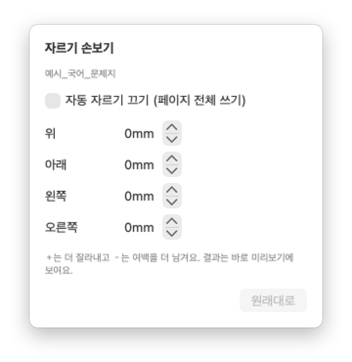

<p align="center"></p>

<h1 align="center">모고 프린트</h1>

<p align="center">모의고사 PDF를 끌어다 놓으면 여백을 잘라 A4에 꽉 차게 맞추고, 미리보기 후 바로 인쇄하는 맥 앱</p>

<p align="center"></p>

[English](#english)

## 왜 만들었나요
평가원·교육청 모의고사 PDF는 A3 크기예요. 집에 있는 A4 프린터로 그냥 뽑으면 A3의 넓은 바깥 여백까지 같이 줄어들어서
글자가 원본의 71% 크기로 작아져요. 모고 프린트는 내용이 없는 바깥 여백을 먼저 잘라 낸 뒤 A4에 꽉 차게 놓아서,
같은 A4 한 장에 글자를 원본의 약 80% 크기로 담아요.

<p align="center"></p>

## 이런 걸 해 줘요
- **여백 자동 자르기**: 쪽마다 내용이 있는 영역을 찾아 잘라요. 한 파일 안에서는 모든 쪽을 같은 범위로 잘라서 글자 크기가 쪽마다 같아요.
- **홀수형·짝수형 고르기**: 2026 수능 국어·수학·영어처럼 두 형이 한 파일에 합쳐진 PDF는 원하는 형만 뽑아요. 정답표도 형별로 나눠져요.
- **양면 인쇄 준비**: 쪽수가 홀수인 과목 뒤에는 빈 쪽을 넣어서 다음 과목이 새 종이에서 시작해요.
- **미리보기 후 인쇄**: 썸네일로 쪽을 넘겨 보고, 확인 창에서 프린터·분량·설정을 본 다음 인쇄해요. 기본값은 A4, 양면(긴 쪽 넘김), 흑백이에요.
- **손으로 고치기**: 자동으로 잘린 범위가 마음에 안 들면 파일마다 위·아래·왼쪽·오른쪽을 mm 단위로 조정해요.
- **프린터 여백 확인**: 종이 여백이 프린터가 찍을 수 있는 범위보다 좁으면 미리 알려 줘요.
- **명령줄 도구**: 같은 기능을 터미널에서 `mogo-cli`로 쓸 수 있어요. 아래 [명령줄로 쓰기](#명령줄로-쓰기)를 보세요.

## 설치
아직 완성된 앱 파일은 배포하지 않아서 직접 빌드해야 해요. macOS 14 이상과 Xcode(또는 Command Line Tools)가 필요해요.

```bash
git clone https://github.com/fattaillabs/mogo-print.git
cd mogo-print/macos
bash build_app.sh
open build/MogoPrint.app
```

만들어진 `build/MogoPrint.app`을 응용 프로그램 폴더로 옮겨 두면 Dock에서 바로 쓸 수 있어요.

## 사용법

### 1. 시험지 PDF를 끌어다 놓아요
앱 창이나 Dock 아이콘에 PDF를 놓아요. 여러 파일이나 폴더도 한 번에 돼요(폴더는 하위 폴더까지 펼쳐요). `⌘O`로 골라도 돼요.

<p align="center"></p>

### 2. 순서와 설정을 확인해요
왼쪽 목록에서 과목 순서를 끌어서 바꾸고, 홀·짝 합본이면 시험지 형을 골라요. 파일마다 "몇 쪽 · 몇 %"가 보이고,
합본에는 `홀·짝 합본`, 뒤에 빈 쪽이 들어가는 파일에는 `+빈 쪽`이 붙어요. 오른쪽 미리보기가 실제로 인쇄될 A4 그대로예요.

자동으로 잘린 범위가 마음에 안 들면 파일 옆 자르기 버튼(크롭 아이콘)을 눌러 손봐요. `+`는 더 잘라 내고 `−`는 여백을 더 남겨요.

<p align="center"></p>

### 3. 인쇄해요
`인쇄…`(⌘P)를 누르면 확인 창이 떠요. 프린터, 분량, 양면·흑백 설정을 보고 `인쇄`를 누르면 바로 프린터로 가요.
인쇄 대신 `PDF로 저장…`으로 A4 PDF만 받을 수도 있어요.

<p align="center"></p>

### 예시 문제지로 먼저 써 보기
[`docs/demo`](docs/demo)에 수능 문제지 판형을 흉내 내 만든 예시 PDF가 두 개 있어요(국어 홀·짝 합본 4쪽, 수학 3쪽).
시험지를 받기 전에 이 폴더를 끌어다 놓아 보면 어떻게 동작하는지 바로 볼 수 있어요.

## 명령줄로 쓰기
앱 안에 명령줄 도구 `mogo-cli`가 같이 들어 있어요. 자르기·배치 규칙은 앱과 똑같아요.

```bash
# 터미널에서 mogo-cli로 부를 수 있게 링크 만들기 (앱을 응용 프로그램 폴더로 옮긴 경우)
sudo ln -s /Applications/MogoPrint.app/Contents/MacOS/mogo-cli /usr/local/bin/mogo-cli
```

입력만 주면 어떻게 배치될지 요약만 보여 줘요.

```console
$ mogo-cli docs/demo
예시_국어_문제지: 4쪽 → 2쪽, 80%  (자른 여백 왼26 위36 오23 아래24mm)  홀·짝 합본→홀수형
예시_수학_문제지: 3쪽 → 3쪽, 80%  (자른 여백 왼26 위36 오23 아래24mm)
합계: A4 5쪽, 종이 3장 (양면)
```

`-o`로 A4 PDF를 저장하고, `-p`로 바로 인쇄해요.

```console
$ mogo-cli --variant even -o 국어_짝수형.pdf ~/Downloads/2026수능_국어_문제지.pdf
2026수능_국어_문제지: 40쪽 → 20쪽, 80%  (자른 여백 왼29 위37 오24 아래25mm)  홀·짝 합본→짝수형
합계: A4 20쪽, 종이 10장 (양면)
저장: 국어_짝수형.pdf

$ mogo-cli -p --copies 2 ~/Downloads/모의고사/       # 폴더째, 양면·흑백으로 2부 인쇄
$ mogo-cli -p --dry-run --copies 2 docs/demo          # 실제로 보내지 않고 lp 명령만 보기
합계: A4 6쪽, 종이 3장 (양면)
보낼 명령: lp -d My_Printer -n 2 -t '예시_국어_문제지, 예시_수학_문제지' -o media=A4 -o sides=two-sided-long-edge -o print-color-mode=monochrome -o collate=true ...
```

| 옵션 | 설명 |
|---|---|
| `-o`, `--output 파일.pdf` | A4로 배치한 PDF를 저장 |
| `-p`, `--print` | 바로 인쇄 (기본: 양면 긴 쪽 넘김, 흑백, 1부) |
| `--dry-run` | `--print`와 함께 쓰면 보내지 않고 lp 명령만 보여 줌 |
| `--json` | 요약을 JSON으로 출력 (쪽수, 자른 여백, 배율 등) |
| `--variant odd\|even\|all` | 홀·짝 합본 파일에서 고를 형 (기본 `odd`) |
| `--margin mm` | 종이 여백 (기본 5) |
| `--trim 위,아래,왼쪽,오른쪽` | 자를 범위를 mm 단위로 손봄 (`+`는 더 자르고 `-`는 넓힘) |
| `--whole-page` | 자동 자르기를 끄고 페이지 전체를 씀 |
| `--printer 이름` | 프린터 지정 (`--list-printers`로 목록 확인) |
| `--copies N`, `--single-sided`, `--color` | 부수, 단면, 컬러 |
| `-h`, `--help` | 도움말 |

## 시험지 PDF는 어디서 받나요
이 저장소에는 실제 시험지가 들어 있지 않아요. 문제지 저작권은 한국교육과정평가원에 있어서 다시 배포할 수 없거든요.
- 수능·모의평가: [평가원 수능 홈페이지 기출문제](https://www.suneung.re.kr/boardCnts/list.do?boardID=1500234&m=0403&s=suneung)
- 교육청 학력평가: EBSi 기출문제

탐구 영역이나 예전 문제지는 ZIP으로 올라와 있으니 압축을 풀고 폴더째 끌어다 놓으면 돼요.

## 폴더 구성
```
macos/     맥 앱과 명령줄 도구 (Swift, SwiftUI, PDFKit). 빌드·테스트 방법은 macos/README.md
windows/   윈도우판 (준비 중)
docs/      자르기·배치 규칙(ALGORITHM.md), 샘플별 정답값(expected/), 예시 문제지(demo/), README 그림(images/)
```
맥판과 윈도우판은 같은 규칙을 따르고, 같은 시험지로 같은 결과가 나오는지 정답값 파일로 확인해요.

## 라이선스
[MIT](LICENSE). 한국교육과정평가원, 시·도 교육청과는 관계없는 도구예요.

---

## English

**mogo-print** prints Korean college entrance mock exams ("모고" is students' slang for 모의고사, mock exam) on a home printer.

The official exam PDFs are A3 with wide margins, so printing them on A4 as is shrinks the text to 71%.
Drop the PDFs onto the app and it trims the empty margins, lays every page out on A4 at about 80% of the original size,
shows a preview, and prints double-sided in grayscale. It also picks one version out of PDFs that bundle both exam versions
(홀수형/짝수형) and inserts blank pages so every subject starts on a new sheet. A command line tool, `mogo-cli`,
does the same from the terminal.

- macOS 14 or later for now. A Windows version is planned.
- Build: `cd macos && bash build_app.sh`, then open `build/MogoPrint.app`.
- Try it with the sample PDFs in `docs/demo` (made for this project, not real exams).
- Real exam PDFs are not included because they are copyrighted by KICE. This project is not affiliated with KICE.
- MIT licensed.
