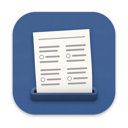
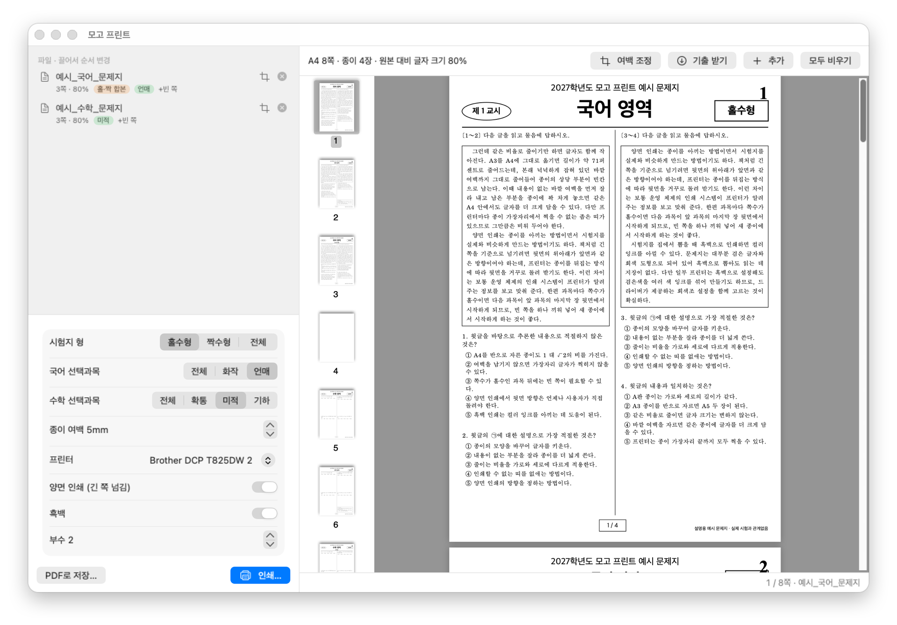
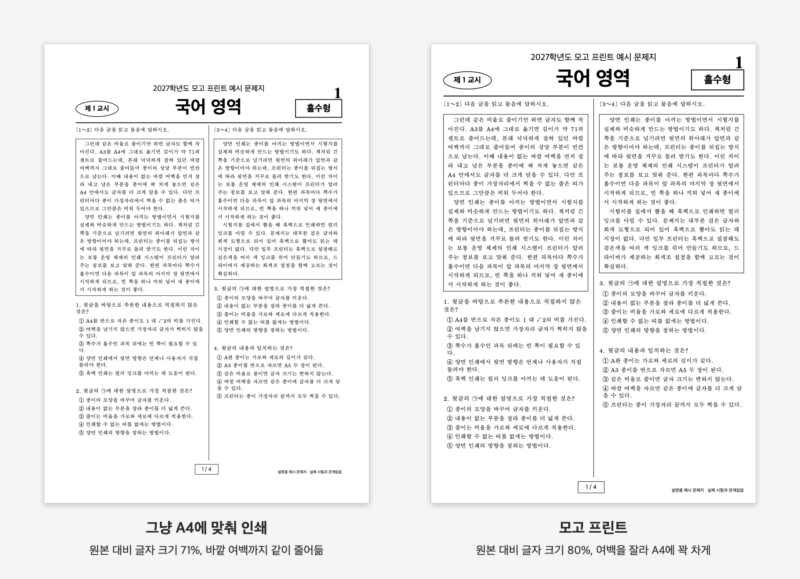
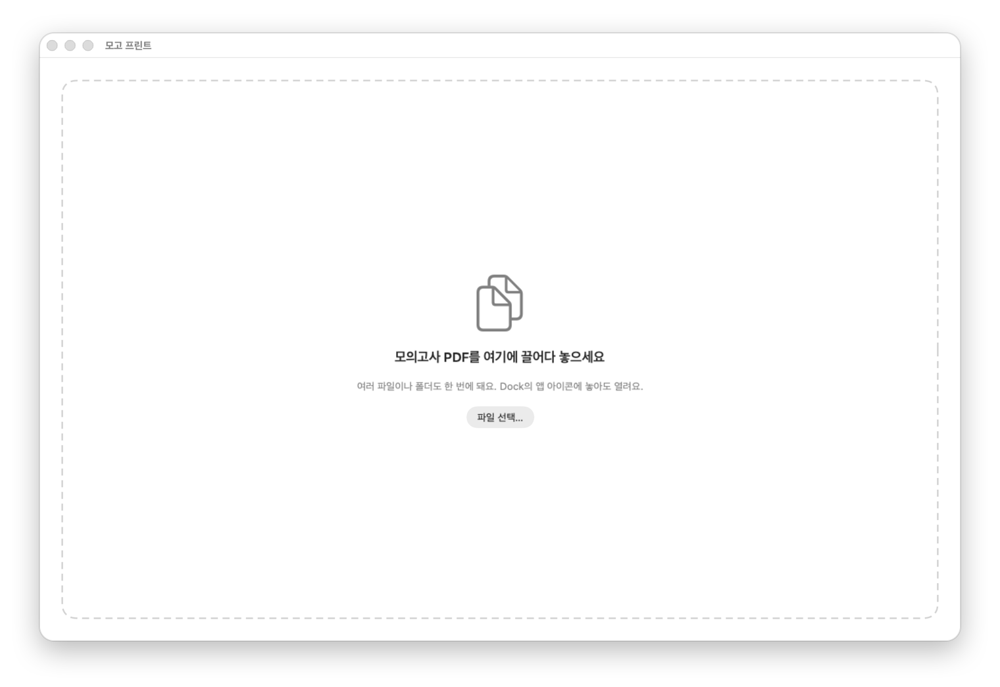
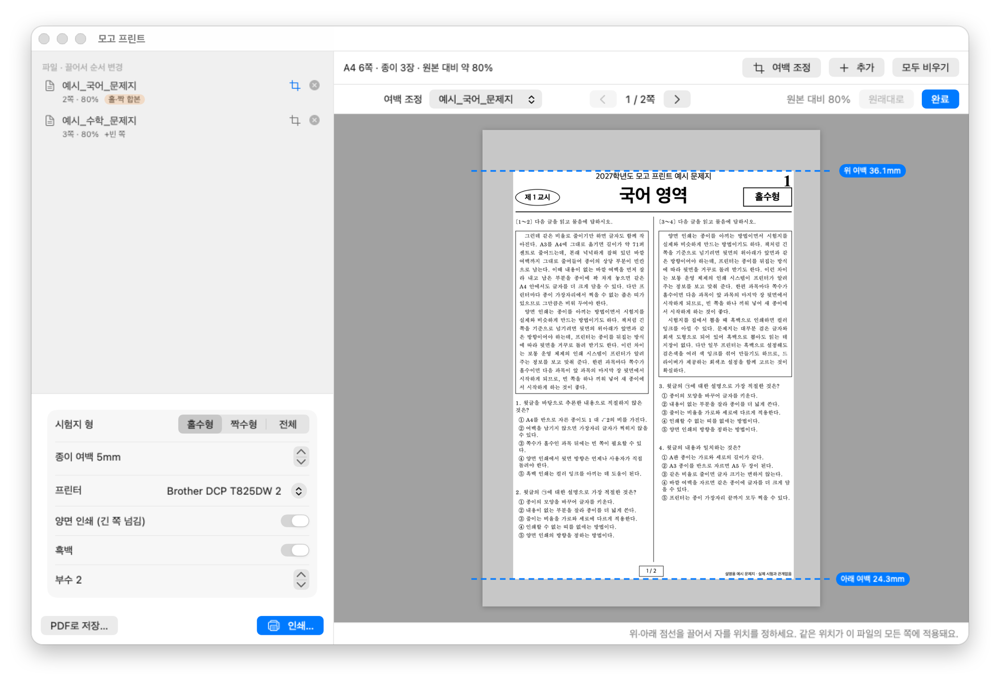
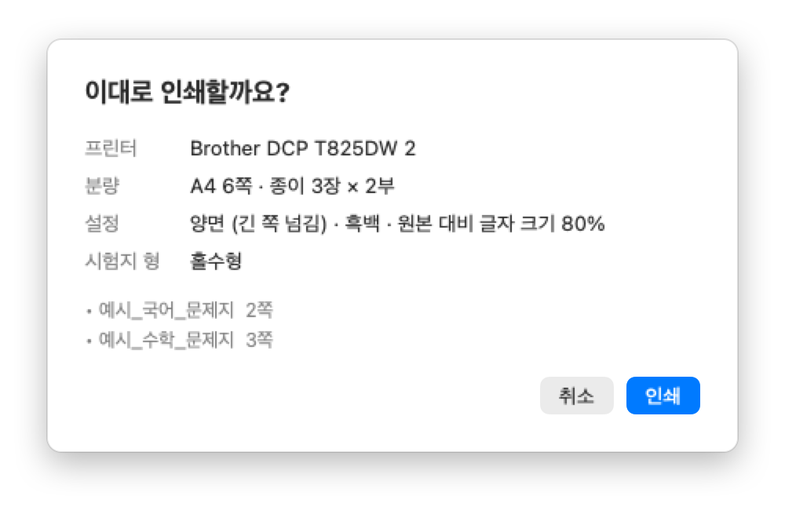
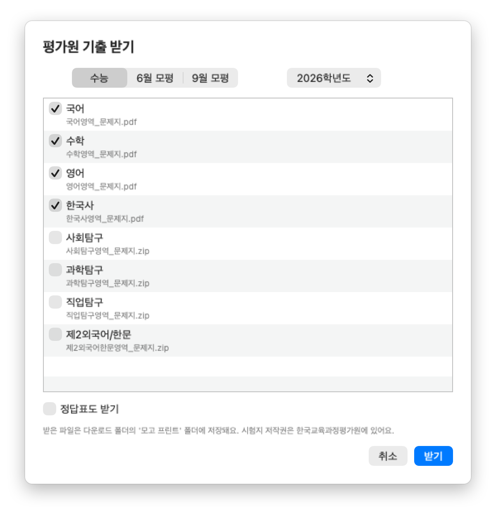

<p align="center"></p>

<h1 align="center">모고 프린트</h1>

<p align="center">모의고사 PDF를 A4에 맞춰 인쇄하는 macOS·Windows 앱</p>

<p align="center"></p>

[English](#english)

## 소개

모고 프린트는 평가원·교육청 모의고사 PDF를 집에 있는 A4 프린터로 인쇄하기 좋게 다시 배치하는 macOS·Windows 앱입니다.
PDF를 창에 끌어다 놓으면 바깥 여백을 자동으로 잘라 A4에 맞추고, 미리보기로 확인한 뒤 바로 인쇄할 수 있습니다.
같은 작업을 터미널에서 하는 명령줄 도구도 함께 들어 있습니다.

## 만든 이유

모의고사 PDF는 A3 크기로 배포됩니다. 이를 A4 프린터로 그대로 인쇄하면 넓은 바깥 여백까지 함께 줄어들어
글자가 원본의 71% 크기로 작아집니다. 모고 프린트는 내용이 없는 여백을 먼저 잘라 내고 남은 부분을 A4에 꽉 차게 놓기 때문에,
같은 A4 한 장에 글자를 원본의 약 80% 크기로 담을 수 있습니다.

<p align="center"></p>

## 특징

- **여백 자동 자르기.** 쪽마다 내용이 있는 영역을 찾아 자릅니다. 한 파일 안의 쪽은 모두 같은 범위로 잘라서 쪽마다 글자 크기가 달라지지 않습니다.
- **홀수형·짝수형 선택.** 2026학년도 수능 국어·수학·영어처럼 두 형이 한 파일에 들어 있으면 원하는 형만 골라 인쇄합니다. 정답표도 형별로 나뉩니다.
- **선택과목만 인쇄.** 2022~2027학년도 국어(화법과 작문·언어와 매체)와 수학(확률과 통계·미적분·기하) 시험지에서 자신이 고른 선택과목과 공통 과목 쪽만 인쇄합니다. 2026학년도 수능 기준으로 국어는 20쪽에서 16쪽, 수학은 20쪽에서 12쪽으로 줄어듭니다.
- **양면 인쇄 대비.** 쪽수가 홀수인 과목 뒤에 빈 쪽을 넣어 다음 과목이 새 종이에서 시작합니다.
- **인쇄 전 확인.** 실제로 인쇄될 A4를 그대로 미리 보고, 프린터와 분량, 설정을 확인한 뒤 인쇄합니다. 기본 설정은 A4, 양면(긴 쪽 넘김), 흑백입니다.
- **여백 수동 조정.** 자동으로 잘린 범위가 맞지 않으면 원본 쪽 위에 표시되는 네 변의 점선을 마우스로 끌어 자를 위치를 바꿀 수 있습니다.
- **프린터 여백 검사.** 종이 여백이 프린터가 인쇄할 수 있는 범위보다 좁으면 미리 경고합니다.
- **평가원에서 바로 받기.** 수능, 6월·9월 모의평가 시험지를 학년도와 영역만 골라 평가원 홈페이지에서 받아 목록에 넣습니다. ZIP으로 올라온 탐구·예전 시험지도 풀어서 넣습니다.
- **명령줄 도구.** 터미널에서 `mogo-cli`로 같은 작업을 할 수 있습니다.

## 설치

### macOS

1. **[최신 버전 내려받기 (MogoPrint.dmg)](https://github.com/fattaillabs/mogo-print/releases/latest/download/MogoPrint.dmg)**
2. 내려받은 `MogoPrint.dmg`를 더블클릭해 엽니다.
3. 열린 창에서 `MogoPrint`를 옆의 `응용 프로그램` 폴더로 끌어다 놓습니다.
4. 응용 프로그램 폴더나 Launchpad에서 `MogoPrint`를 실행합니다.
   처음 실행할 때 "인터넷에서 다운로드한 앱입니다. 열겠습니까?"라는 확인 창이 뜨면 `열기`를 누릅니다.
5. 설치가 끝나면 바탕화면이나 Finder 사이드바의 `모고 프린트` 디스크를 꺼내고, 내려받은 DMG 파일은 지워도 됩니다.

- **지원 환경**: macOS 14 Sonoma 이상, Apple Silicon(M1 이후)과 Intel 맥 모두 지원합니다.
- **보안**: 애플의 공증(notarization)을 받은 앱이라 "확인되지 않은 개발자" 경고 없이 열립니다.
- **다운로드 폴더 접근**: `평가원에서 받기`를 처음 쓸 때 "다운로드 폴더에 접근하려고 합니다"라는 창이 뜹니다. 받은 시험지를 저장하려면 `허용`을 누르세요.
- **업데이트**: 새 버전 DMG를 받아 같은 방법으로 응용 프로그램 폴더에 덮어씁니다. 고른 선택과목 같은 설정은 그대로 남습니다.
- **삭제**: 응용 프로그램 폴더의 `MogoPrint`를 휴지통으로 옮깁니다. 받은 시험지는 다운로드 폴더의 `모고 프린트` 폴더에 그대로 있습니다.

### Windows

1. **[최신 버전 내려받기 (MogoPrint-windows-x64.zip)](https://github.com/fattaillabs/mogo-print/releases/latest/download/MogoPrint-windows-x64.zip)**
2. 내려받은 zip 파일을 마우스 오른쪽 버튼으로 눌러 `압축 풀기`를 고릅니다.
3. 압축을 푼 `MogoPrint.exe`를 원하는 폴더(예: `문서`)에 두고 실행합니다. 따로 설치하는 과정은 없습니다.
4. 처음 실행할 때 "Windows의 PC 보호" 창이 뜨면 `추가 정보`를 누른 뒤 `실행`을 누릅니다.
   코드 서명 인증서가 없는 앱이라 처음 한 번 뜨는 창입니다.
5. 자주 쓴다면 `MogoPrint.exe`를 마우스 오른쪽 버튼으로 눌러 `시작 화면에 고정`하거나 바탕 화면에 바로 가기를 만듭니다.
   바로 가기 아이콘에 PDF를 끌어다 놓아도 열립니다.

- **지원 환경**: Windows 10·11 64비트. .NET을 따로 설치하지 않아도 됩니다.
- **업데이트**: 새 버전의 `MogoPrint.exe`로 바꿉니다. 고른 선택과목 같은 설정은 그대로 남습니다.
- **삭제**: `MogoPrint.exe`를 지웁니다. 설정은 `%APPDATA%\MogoPrint` 폴더에, 받은 시험지는 다운로드 폴더의 `모고 프린트` 폴더에 남습니다.

지난 버전과 바뀐 내용은 [릴리스 페이지](https://github.com/fattaillabs/mogo-print/releases)에서 볼 수 있습니다.

### 소스에서 빌드하기

직접 빌드하려면 Xcode(또는 Command Line Tools)가 필요합니다.

```bash
git clone https://github.com/fattaillabs/mogo-print.git
cd mogo-print/macos
bash build_app.sh
open build/MogoPrint.app
```

Windows 버전은 [.NET 10 SDK](https://dotnet.microsoft.com/download)로 빌드합니다.

```powershell
git clone https://github.com/fattaillabs/mogo-print.git
cd mogo-print\windows
dotnet run --project MogoPrint
```

## 사용법

아래 화면은 macOS 버전이며, Windows 버전도 화면 구성과 사용법이 같습니다. 단축키는 macOS의 `⌘`를 Windows에서는 `Ctrl`로 씁니다.

### 1. PDF 넣기

앱 창에 시험지 PDF를 끌어다 놓습니다. macOS는 Dock 아이콘에, Windows는 프로그램 아이콘이나 바로 가기에 놓아도 열립니다.
여러 파일이나 폴더를 한 번에 넣을 수 있고, 폴더는 하위 폴더까지 읽습니다.
`⌘O`(Windows `Ctrl+O`)로 파일을 골라도 됩니다. Windows의 파일 선택 창에서는 폴더를 고를 수 없으니 폴더는 창에 끌어다 놓습니다.
평가원 시험지는 `평가원에서 받기…`(`⇧⌘O`, Windows `Ctrl+Shift+O`)로 바로 받을 수도 있습니다(아래 참고).

<p align="center"></p>

### 2. 순서와 설정 확인

왼쪽 목록에서 과목을 끌어 순서를 바꾸고, 홀·짝 합본 파일이 있으면 시험지 형을 고릅니다.
국어·수학 시험지가 있으면 "국어 선택과목", "수학 선택과목" 설정이 나타나며, 고른 과목은 다음 실행 때도 유지됩니다.
목록에는 파일마다 쪽수와 배율이 나오고, 합본 파일에는 `홀·짝 합본`, 뒤에 빈 쪽이 들어가는 파일에는 `+빈 쪽` 표시가 붙습니다.
오른쪽 미리보기는 실제로 인쇄될 A4와 같습니다.

A4 가장자리에 남길 흰 여백은 왼쪽 아래 설정의 "종이 여백"에서 3~15mm 사이로 정합니다(기본 5mm).

자동으로 잘린 범위를 바꾸려면 미리보기 위의 `여백 조정`이나 파일 옆의 자르기 버튼을 누릅니다.
미리보기가 원본 쪽 전체로 바뀌면서 잘려 나갈 여백이 흐리게 보이고, 위·아래·왼쪽·오른쪽 자르는 위치가 점선으로 나타납니다.
점선에 마우스를 올리면 양쪽 화살표 커서로 바뀌고, 끌면 자를 위치와 배율이 바로 바뀝니다. 같은 위치가 그 파일의 모든 쪽에 적용됩니다.
쪽을 넘겨 다른 쪽이 잘리지 않는지 확인한 뒤 `완료`를 누르면 A4 미리보기로 돌아갑니다. `원래대로`를 누르면 자동으로 잡은 위치로 되돌아갑니다.

<p align="center"></p>

### 3. 인쇄

`인쇄…`(⌘P, Windows `Ctrl+P`)를 누르면 확인 창이 열립니다. 프린터와 분량, 양면·흑백 설정을 확인하고 `인쇄`를 누르면 바로 프린터로 전송됩니다.
인쇄하지 않고 `PDF로 저장…`으로 A4 PDF만 저장할 수도 있습니다.

Windows 버전은 고른 프린터가 양면 인쇄를 지원하지 않으면 단면으로 계산해 빈 쪽을 넣지 않고, 설정 칸과 확인 창에서 알려 줍니다.

<p align="center"></p>

### 평가원에서 받기

`평가원에서 받기…` 또는 미리보기 위의 `기출 받기`를 누르면 평가원 수능 홈페이지의 기출문제 목록을 불러옵니다.
시험(수능, 6월 모평, 9월 모평)과 학년도를 고르고 받을 영역에 체크한 뒤 `받기`를 누르면 다운로드 폴더의 `모고 프린트` 폴더에 저장하고 목록에 넣습니다.
탐구처럼 과목 여러 개가 한 파일로 올라오는 영역은 받은 뒤 응시할 과목만 고르면 됩니다. `정답표도 받기`를 켜면 정답표도 함께 받습니다.

<p align="center"></p>

### 예시 문제지

[`docs/demo`](docs/demo) 폴더에는 수능 문제지 판형을 본떠 만든 예시 PDF 두 개가 있습니다.
국어는 홀·짝 합본 8쪽(형마다 공통 2쪽, 화법과 작문·언어와 매체 1쪽씩), 수학은 5쪽(공통 2쪽, 확률과 통계·미적분·기하 1쪽씩)입니다.
실제 시험지를 내려받기 전에 이 폴더를 앱에 넣어 동작을 확인할 수 있습니다.

## 명령줄 도구

앱 안에 명령줄 도구 `mogo-cli`가 함께 들어 있으며, 자르기와 배치 규칙은 앱과 같습니다.
터미널에서 바로 실행하려면 아래처럼 링크를 만듭니다(앱을 응용 프로그램 폴더로 옮긴 경우).

```bash
sudo ln -s /Applications/MogoPrint.app/Contents/MacOS/mogo-cli /usr/local/bin/mogo-cli
```

Windows에서는 [mogo-cli-windows-x64.zip](https://github.com/fattaillabs/mogo-print/releases/latest/download/mogo-cli-windows-x64.zip)을 받아
압축을 푼 `mogo-cli.exe`를 씁니다. 옵션은 같고, `--dry-run`은 lp 명령 대신 프린터가 받아들일 설정을 보여 줍니다.

파일만 지정하면 배치 결과를 요약해서 보여 줍니다.

```console
$ mogo-cli docs/demo
예시_국어_문제지: 8쪽 → 4쪽, 80%  (자른 여백 왼26 위36 오23 아래24mm)  홀·짝 합본→홀수형, 선택과목→전체(화작·언매)
예시_수학_문제지: 5쪽 → 5쪽, 80%  (자른 여백 왼26 위36 오23 아래24mm)  선택과목→전체(확통·미적·기하)
합계: A4 9쪽, 종이 5장 (양면)
```

`--elective`로 선택과목을 고르고, `-o`로 A4 PDF를 저장하고, `-p`로 바로 인쇄합니다.

```console
$ mogo-cli --elective 언매 --elective 미적 ~/Downloads/2026수능_국어_문제지.pdf ~/Downloads/2026수능_수학_문제지.pdf
2026수능_국어_문제지: 40쪽 → 16쪽, 80%  (자른 여백 왼29 위37 오24 아래25mm)  홀·짝 합본→홀수형, 선택과목→언매
2026수능_수학_문제지: 40쪽 → 12쪽, 80%  (자른 여백 왼29 위37 오24 아래25mm)  홀·짝 합본→홀수형, 선택과목→미적
합계: A4 28쪽, 종이 14장 (양면)

$ mogo-cli --variant even -o 국어_짝수형.pdf ~/Downloads/2026수능_국어_문제지.pdf
2026수능_국어_문제지: 40쪽 → 20쪽, 80%  (자른 여백 왼29 위37 오24 아래25mm)  홀·짝 합본→짝수형, 선택과목→전체(화작·언매)
합계: A4 20쪽, 종이 10장 (양면)
저장: 국어_짝수형.pdf

$ mogo-cli -p --copies 2 ~/Downloads/모의고사/       # 폴더 전체를 양면·흑백으로 2부 인쇄
$ mogo-cli -p --dry-run --copies 2 docs/demo          # 실제로 보내지 않고 lp 명령만 출력
합계: A4 10쪽, 종이 5장 (양면)
보낼 명령: lp -d My_Printer -n 2 -t '예시_국어_문제지, 예시_수학_문제지' -o media=A4 -o sides=two-sided-long-edge -o print-color-mode=monochrome -o collate=true ...
```

평가원에서 시험지를 받을 수도 있습니다. 받은 파일 경로를 한 줄씩 출력합니다.

```console
$ mogo-cli --download 수능 2026 --area 국어,수학,사회탐구
~/Downloads/모고 프린트/2026학년도 대학수학능력시험/2026수능_국어영역_문제지.pdf
~/Downloads/모고 프린트/2026학년도 대학수학능력시험/2026수능_수학영역_문제지.pdf
~/Downloads/모고 프린트/2026학년도 대학수학능력시험/2026수능_사회탐구영역_문제지/01 생활과 윤리_문제.pdf
...
```

| 옵션 | 설명 |
|---|---|
| `-o`, `--output 파일.pdf` | A4로 배치한 PDF 저장 |
| `-p`, `--print` | 바로 인쇄 (기본: 양면 긴 쪽 넘김, 흑백, 1부) |
| `--dry-run` | `--print`와 함께 쓰면 실제로 보내지 않고 lp 명령(Windows는 프린터가 받아들일 설정)만 출력 |
| `--print-to-file 파일` | Windows만. `--print`와 함께 쓰면 프린터 출력을 파일로 저장 (Microsoft Print to PDF 등) |
| `--json` | 요약을 JSON으로 출력 (쪽수, 자른 여백, 배율 등) |
| `--variant odd\|even\|all` | 홀·짝 합본 파일에서 고를 형 (기본 `odd`) |
| `--elective 과목` | 고를 선택과목: `화작`, `언매`, `확통`, `미적`, `기하` (국어·수학 하나씩, 여러 번 사용) |
| `--margin mm` | 종이 여백 (기본 5) |
| `--trim 위,아래,왼쪽,오른쪽` | 자를 범위를 mm 단위로 조정 (`+`는 더 자르기, `-`는 넓히기) |
| `--whole-page` | 자동 자르기를 끄고 페이지 전체 사용 |
| `--printer 이름` | 프린터 지정 (목록은 `--list-printers`) |
| `--copies N`, `--single-sided`, `--color` | 부수, 단면, 컬러 |
| `--download 시험 학년도` | 평가원에서 시험지 받기 (시험: `수능`, `6월`, `9월`). 학년도를 빼면 고를 수 있는 학년도 출력 |
| `--area 영역,...`, `--answers`, `--to 폴더` | 받을 영역(기본 전체), 정답표도 받기, 저장 폴더(기본 `~/Downloads/모고 프린트`) |
| `-h`, `--help` | 도움말 |

## 시험지 PDF 구하기

이 저장소에는 실제 시험지가 들어 있지 않습니다. 시험지의 저작권은 한국교육과정평가원에 있어 다시 배포할 수 없습니다.
앱의 `평가원에서 받기`를 쓰거나 아래에서 직접 내려받아 사용하세요.

- 수능·모의평가: [평가원 수능 홈페이지 기출문제](https://www.suneung.re.kr/boardCnts/list.do?boardID=1500234&m=0403&s=suneung)
- 교육청 학력평가: EBSi 기출문제

탐구 영역과 예전 시험지는 ZIP 파일로 올라와 있습니다. 압축을 푼 폴더를 그대로 앱에 넣으면 됩니다.

## 폴더 구성

```
macos/     macOS 앱과 명령줄 도구 (Swift, SwiftUI, PDFKit). 빌드와 테스트는 macos/README.md 참고
windows/   Windows 앱과 명령줄 도구 (C#, WPF, PDFium). 빌드와 테스트는 windows/README.md 참고
docs/      자르기·배치 규칙(ALGORITHM.md), 시험지별 기준값(expected/), 예시 문제지(demo/), README 이미지(images/)
```

macOS 버전과 Windows 버전은 같은 규칙을 따르며, 같은 시험지에서 같은 결과가 나오는지 기준값 파일로 검증합니다.

## 라이선스

[MIT 라이선스](LICENSE)로 배포합니다. 한국교육과정평가원 및 시·도 교육청과는 관련이 없습니다.

---

## English

**mogo-print** prints Korean college entrance mock exams ("모고" is students' slang for 모의고사, mock exam) on a home printer.

The official exam PDFs are A3 with wide margins, so printing them on A4 as is shrinks the text to 71%.
Drop the PDFs onto the app and it trims the empty margins, lays every page out on A4 at about 80% of the original size,
shows a preview, and prints double-sided in grayscale. It can also download past exams directly from the KICE website. It also picks one version out of PDFs that bundle both exam versions
(홀수형/짝수형), prints only the elective you take in Korean and math (2022–2027 exams),
and inserts blank pages so every subject starts on a new sheet. A command line tool, `mogo-cli`,
does the same from the terminal.

- macOS 14 or later (Apple Silicon and Intel), and Windows 10/11 (64-bit).
- Install on macOS: download [MogoPrint.dmg](https://github.com/fattaillabs/mogo-print/releases/latest/download/MogoPrint.dmg) (signed and notarized), open it, and drag MogoPrint to Applications.
- Install on Windows: download [MogoPrint-windows-x64.zip](https://github.com/fattaillabs/mogo-print/releases/latest/download/MogoPrint-windows-x64.zip), extract it, and run `MogoPrint.exe` (no installer, no .NET install needed). The app is not code-signed, so SmartScreen asks once: choose "More info", then "Run anyway".
- Build from source: `cd macos && bash build_app.sh` on macOS, or `cd windows && dotnet run --project MogoPrint` with the .NET 10 SDK on Windows.
- Try it with the sample PDFs in `docs/demo` (made for this project, not real exams).
- Real exam PDFs are not included because they are copyrighted by KICE. This project is not affiliated with KICE.
- MIT licensed.
